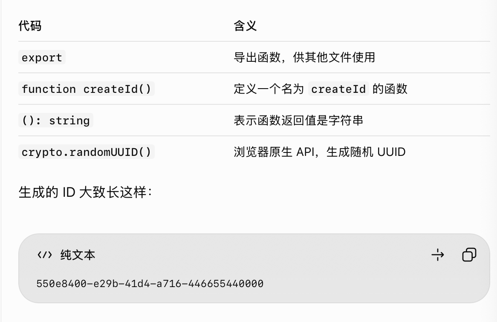

所使用的知识点，项目结构图，功能设计思想，环境变量和git配置
分析并理解这个项目仓库，生成结构化的完整的Code Wiki文档(md文件)。这套文档需要包括项目整体架构、主要模块职责、关键类与函数说明、依赖关系以及项目运行方式等关键信息
包含代码和含义

每个阶段解决的问题、知识点、理解、每个章节完成清单、每节完成目标及完成情况

疑问：后端保存的消息结构只有：
{
  role: "user",
  content: "你好"
}
而前端的 Message 类型还需要 id：
export interface Message {
  id: string;
  role: MessageRole;
  content: string;
}
后台需要id吗？